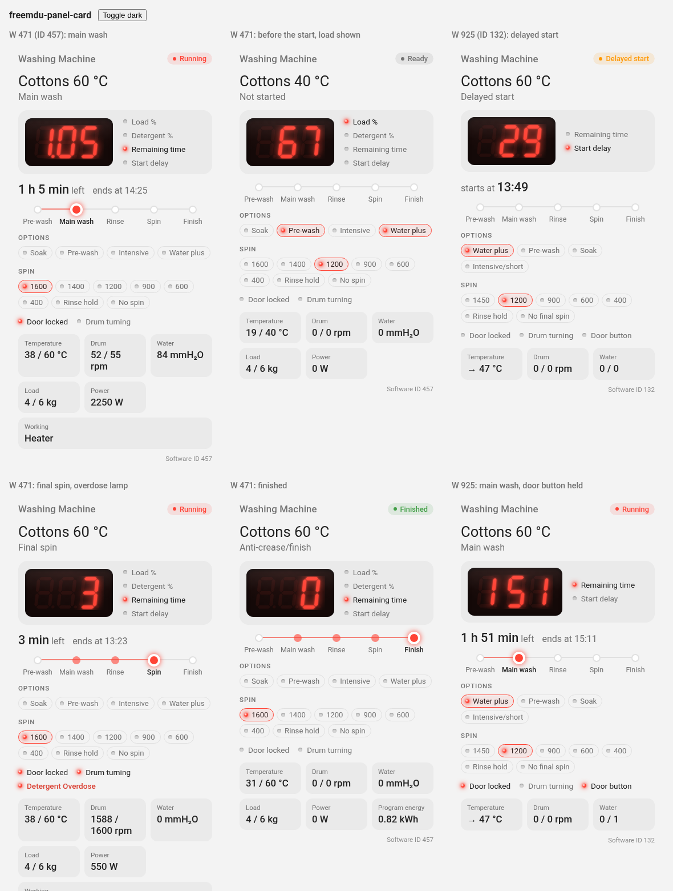
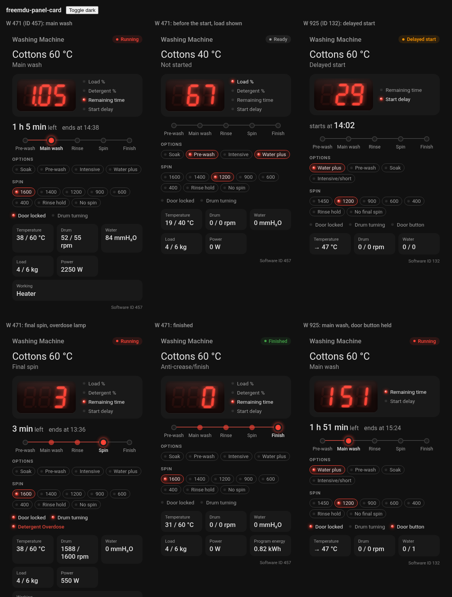

# FreeMDU ESPHome

The FreeMDU ESPHome component integrates Miele appliances into [ESPHome](https://esphome.io) through their optical diagnostic interface. It uses the device implementations of the [protocol](../protocol) crate unchanged, so every appliance FreeMDU supports works without porting anything to C++.

It is an alternative to the **standalone mode** of the [home](../home) firmware for people who already run ESPHome. On top of what the home firmware offers, ESPHome provides:

- over-the-air updates, so an adapter mounted inside an appliance does not need USB again,
- logs over the network, including the reason a poll failed,
- configuration in YAML instead of compile-time settings,
- the native Home Assistant API instead of MQTT discovery,
- an [energy estimate](#estimating-energy-use) for appliances that do not measure their own consumption.

> [!NOTE]
> The component is read-only for now: it publishes properties but does not expose actions.

## Getting started

### Hardware

The component uses the same communication adapter as the home firmware: an ESP32-C3 or ESP32-C6 and an SFH 7250 infrared emitter and phototransistor, wired as described in the [home README](../home/README.md#getting-started). The RX and TX pins can be any free GPIOs; the [board package](packages/xiao-esp32c6.yaml) uses pin `0` as RX and `1` as TX like the home firmware.

The **ESP32-C6** has been tested, on a Seeed XIAO ESP32-C6 with a Miele W 471 (software ID 457). The ESP32-C3 build links, but has not been tried on hardware yet.

### Installation with packages

Ready-made [packages](packages) cover everything that is the same for every adapter of one kind and every appliance of one software ID: the board and its UART, the component, and an entity for each property with its name, unit and category. A complete configuration for a W 471 on a XIAO ESP32-C6 is then:

```yaml
esphome:
  name: washing-machine
  friendly_name: Washing Machine

packages:
  freemdu:
    url: https://github.com/bubenkoff/FreeMDU
    ref: esphome
    files:
      - esphome/packages/xiao-esp32c6.yaml
      - esphome/packages/id457.yaml
      - esphome/packages/energy.yaml

wifi:
  ssid: !secret wifi_ssid
  password: !secret wifi_password

api:
  encryption:
    key: !secret api_encryption_key

ota:
  - platform: esphome
    encryption: {}
```

This is the [example](example/xiao-esp32c6-w471.yaml). The Rust library is included in prebuilt form, so neither ESPHome nor the Home Assistant add-on needs a Rust toolchain.

| Package | Contents |
|---|---|
| [`xiao-esp32c6.yaml`](packages/xiao-esp32c6.yaml) | Board, ESP-IDF framework, the board LED as a link light (see [Checking the adapter](#checking-the-adapter)), the antenna switch of the XIAO ESP32-C6, and the UART `mdu_uart` on pins `0` (RX) and `1` (TX) |
| [`id457.yaml`](packages/id457.yaml) | Every property of software ID 457 (Miele W 471). `Operating State` keeps the device's codes for automations; the other text sensors show display names. `Load Level` is the machine's own weighing of the dry laundry in kg, and `Program Max Load` the most the selected program takes |
| [`id132.yaml`](packages/id132.yaml) | Every property of software ID 132 (Miele W 8xx/9xx, such as the W 925), including the nine faults. `Remaining Time` and `Display Contents` come from the display's digits, so during a delayed start they count down to the start. `Door Interlock` is worked out from `Water Level` and `Spinning` rather than read, and its thresholds are not yet confirmed. This software ID reports no operating state: Phase shows where a program is, and *Last Program Energy* of the energy package stays unknown, so drop it with `program_energy: !remove` under `freemdu:` → `energy:` |
| [`energy.yaml`](packages/energy.yaml) | The [energy estimate](#estimating-energy-use) with its three sensors. Software IDs 457 and 132 estimate their own power and need no variables; for others, set `heater_power`, and optionally `running_power`, `standby_power` and `drum_power_per_1000_rpm` |
| [`freemdu.yaml`](packages/freemdu.yaml) | Included by every device package: the external component, the logger, the hub (polling every 10 s), and the adapter's `Connected`, `Adapter Status`, `Software ID`, `WiFi Signal`, and the `Adapter Test` button with its `Adapter Test Result` |

Variables of the common part, set under `substitutions:` in your file or as `vars:` of the device package:

| Variable | Default | Description |
|---|---|---|
| `update_interval` | `10s` | How often the appliance is polled. A poll of every property takes a few seconds at 2400 baud; a poll still running when the next is due is skipped |
| `hold_time` | `30s` | How long values are kept while polls fail, before they turn unknown (see [Hub](#hub)) |
| `dashboard_card` | `false` | `true` installs the [front panel card](#front-panel-card) in Home Assistant at every build |
| `freemdu_url`, `freemdu_ref` | this repository | Where the component is built from, to try a branch |
| `freemdu_refresh` | `1d` | How often ESPHome fetches the component again. ESPHome keeps git sources for a day, so after a push to the branch you build from, set this to `always` and add `refresh: always` to your `packages:` entry; otherwise the next day's build picks it up |

Anything in a package can be changed in your own file. Options merge into the package's, for example `freemdu: protocol_log: true`. Every entity has an ID starting with `mdu_` (`mdu_status`, `mdu_drum_speed`, …), so it can be changed or dropped from your file:

```yaml
text_sensor:
  - id: !extend mdu_program
    name: Programme
sensor:
  - id: !remove mdu_drum_speed_target
```

The sensors of the [energy estimate](#estimating-energy-use) are options of the `freemdu:` block rather than list entries, so `- id: !remove` does not reach them; drop one by its option instead:

```yaml
freemdu:
  energy:
    program_energy: !remove
```

A board with other pins needs its own `uart:` block with the ID `mdu_uart` instead of the board package (see [UART](#uart)). For an appliance without a device package, bind the properties yourself, as described in [Configuration](#configuration).

### Installation without packages

Add the component to your device configuration as an external component:

```yaml
external_components:
  - source:
      type: git
      url: https://github.com/bubenkoff/FreeMDU
      ref: esphome
      path: esphome/components
    components: [freemdu]
```

The board must use the ESP-IDF framework:

```yaml
esp32:
  board: seeed_xiao_esp32c6
  variant: esp32c6
  framework:
    type: esp-idf
```

### UART

The diagnostic interface runs at 2400 baud with 8 data bits, even parity and 1 stop bit. With the adapter above, both pins are inverted:

```yaml
uart:
  id: mdu_uart
  rx_pin:
    number: GPIO0
    inverted: true
  tx_pin:
    number: GPIO1
    inverted: true
  baud_rate: 2400
  data_bits: 8
  parity: EVEN
  stop_bits: 1
```

Configuration validation rejects any other baud rate or frame format.

## Configuration

This section describes the options the [packages](packages) are written with, for appliances that have no device package yet or for configurations written by hand.

### Hub

```yaml
freemdu:
  id: mdu
  uart_id: mdu_uart
  update_interval: 10s
```

| Option | Default | Description |
|---|---|---|
| `uart_id` | | The UART bus the adapter is connected to. |
| `update_interval` | `10s` | How often the device is polled. Appliances never send data by themselves, so this is also the delay before a change shows up. Each poll reads every configured property at 2400 baud, so it takes longer the more properties there are. |
| `discard_echo` | `true` | Read back and discard every transmitted byte. Needed for the optical adapter, whose phototransistor also sees its own emitter, reflected by the indicator window. Set to `false` for a wired UART connection. |
| `timeout` | `500ms` | How long to wait for each byte from the device. |
| `hold_time` | `30s` | How long the last values are kept through failed polls before they are reported as unknown. Without it, a single missed poll would interrupt a sequence like *running → finished* that automations rely on. |
| `reconnect_interval` | `1s` | How often to try while the device does not answer, instead of `update_interval`. The appliance then shows up within a second of being switched on, and while the sensor is aligned, the link light answers at once. A repeated failure is logged once, not at every attempt. `0s` keeps `update_interval`. |
| `protocol_log` | `false` | Log every request and transferred byte, at `DEBUG`, so no change to the logger's level is needed. Very verbose; meant for debugging a new device or adapter. Without it, the component logs every change of a property's value at `DEBUG` (`operating_state: ProgramRunning (Running)`), plus connections and failed polls. |
| `memory_log` | | Log a range of the device's memory at every poll, for mapping a new device: `address` and `length` (a multiple of 16, at most 4096). See [Mapping a new device](#mapping-a-new-device). |
| `energy` | | Energy estimate, see [Estimating energy use](#estimating-energy-use). |
| `dashboard_card` | `false` | Copy the [front panel card](#front-panel-card) into Home Assistant's `www/freemdu/` at every build. Works when ESPHome's directory is inside Home Assistant's configuration, as with the add-on; otherwise the build logs a warning and goes on. |

### Properties

Every property of the connected device can be published as a text sensor, a sensor or a binary sensor. The property is selected by its ID, as defined in the device implementation for your software ID, for example [`id457.rs`](../protocol/src/device/id457.rs) or [`id629.rs`](../protocol/src/device/id629.rs).

```yaml
text_sensor:
  - platform: freemdu
    property: operating_state
    name: Operating State

sensor:
  - platform: freemdu
    property: program_spin_speed
    name: Spin Speed
    unit_of_measurement: rpm

  - platform: freemdu
    property: temperature
    value: target
    name: Target Temperature

binary_sensor:
  - platform: freemdu
    property: program_locked
    name: Program Locked
```

Which platform fits depends on the type of the property's value:

| Value type | Text sensor shows | Sensor shows | Binary sensor shows |
|---|---|---|---|
| Boolean | `Yes` / `No` | 1 / 0 | on / off |
| Number | the number | the number | on if not 0 |
| Current/target pair | `current/target` | the half chosen with `value` (`current` or `target`, default `current`) | on if not 0 |
| String (states, programs, phases, flags) | the text | — | — |
| Duration | `17446h 3min` | seconds | — |
| Date | `2002-02-28` | `20020228` | — |
| Fault | `Ok`, `Active (3x, 1200 h)`, `Stored` | 0 ok, 1 active, 2 stored | on if active or stored |

Text sensors take `format`. With `code`, the default, they show the device implementation's own names, such as `ProgramRunning` or `QuickWash40`: these never change, so automations can compare against them. With `text` they show a name for people: the device implementation's display name where it provides one (`Device::value_name`; for software ID 457, e.g. "Running" or "Quick wash 40 °C"), otherwise the identifier split into plain English words ("Program running", and flag sets like `Soak | PreWash` as "Soak, pre wash"). Home Assistant cannot translate ESPHome text sensors itself, so for a dashboard bind the property twice:

```yaml
text_sensor:
  - platform: freemdu
    property: operating_state
    name: Operating State        # ProgramRunning, for automations
    entity_category: diagnostic
  - platform: freemdu
    property: operating_state
    format: text
    name: Status                 # "Running", for people
```

Numbers, dates and durations are not reworded.

Units are not taken over from the device implementation; set `unit_of_measurement`, `device_class` and `state_class` in YAML as for any ESPHome sensor. A duration can be shown in hours with a `multiply: 0.000277778` filter.

Options of the three platforms, on top of the usual ESPHome entity options (`name`, `id`, `icon`, `entity_category`, `filters`, …):

| Option | Platform | Default | Description |
|---|---|---|---|
| `property` | all | | ID of the property to publish. A text sensor needs either this or `info`, a binary sensor either this or `connected`. |
| `value` | sensor | `current` | For current/target pairs: `current` or `target`. |
| `format` | text sensor | `code` | `code` for the implementation's identifiers, `text` for display names, as described above. |
| `info` | text sensor | | Instead of a property: `status`, `software_id` or `device_kind` (see [Adapter information](#adapter-information)). |
| `connected` | binary sensor | | `true`: on while the device answers, instead of a property. |
| `freemdu_id` | all | | The hub, needed only with more than one `freemdu:` block. |

If the connected device has no property with the configured ID, this is logged once and the entity stays unknown. A property can also have no value in the appliance's current state, such as a remaining time while the display shows something else: the entity is then unknown until it has one again, and nothing is logged. Several entities may use the same property; it is queried once per poll.

### Adapter information

```yaml
binary_sensor:
  - platform: freemdu
    connected: true
    name: Connected

text_sensor:
  - platform: freemdu
    info: status
    name: Adapter Status
  - platform: freemdu
    info: software_id
    name: Software ID
  - platform: freemdu
    info: device_kind
    name: Device Kind
  - platform: freemdu
    info: adapter_test
    name: Adapter Test Result

button:
  - platform: freemdu
    adapter_test: true
    name: Adapter Test
```

`connected` is on while the device answers. `status` describes the outcome of the last poll:

| Status | Meaning |
|---|---|
| `Ok` | The poll succeeded. |
| `No answer from the device` | The adapter sees its own transmission, but the appliance does not answer. It is switched off, or the sensor is not aligned with the indicator. |
| `No echo from the sensor` | The adapter does not even see its own transmission. With the sensor on the window, which reflects it whether the appliance is on or off, the fault is in the adapter, not in the alignment: a joint or wire, or the sensor flooded by light. Run the [adapter test](#checking-the-adapter). Off the appliance it is expected, as nothing reflects the emitter. Only with `discard_echo`. |
| `Unsupported software ID` | The appliance answered, but FreeMDU has no implementation for its software ID. The `software_id` text sensor shows which one. |
| `Protocol error` | The appliance answered with something unexpected, for example a wrong checksum. Usually a poor optical link. |
| `Unexpected device state or value` | The device implementation does not recognise a value read from the appliance. |
| `Serial port error` | The UART reported an error. |

### Checking the adapter

The optical sensor sees its own emitter in whatever surface lies in front of it, so the adapter can test itself without the appliance answering: the **Adapter Test** button sends bursts of bytes for a minute and checks that each comes back. The SFH 7250 is a reflective sensor, and next to nothing reaches the receiver from inside the package: held in the air it sees no echo at all. Polling pauses meanwhile. The test bytes are chosen so that no five in a row form a request with a valid checksum, so an appliance that sees them cannot take them for a command. It does not run while the appliance answers, as that already proves the adapter works, nor without `discard_echo`.

1. Give the echo something to come back from: the sensor in its place on the appliance's window, which works with the appliance switched off, or on the bench the lens a few millimetres from white paper. Keep it out of bright light.
2. Press **Adapter Test**. The board LED (with the `xiao-esp32c6` package) lights while the echo comes back.
3. While it runs, press and wiggle each wire, each joint and the sensor itself. Where the LED flickers or goes out, the contact is poor.
4. To check the receiver, hold a phone torch to the lens: the echo must break. Moving the paper away must break it too. To check the emitter, look at the lens through a phone's front camera, which usually sees infrared: the emitter flashes purple during the test.

`Adapter Test Result` then reads:

| Result | Meaning |
|---|---|
| `Echo clean in all N bursts` | The adapter works. If the appliance does not answer, the sensor is off the indicator. |
| `Echo in all N bursts, garbled in X: a weak reflection, enough to poll` | Every byte came back, some of them changed. Polling needs only the bytes, not their values, and the appliance's own answers come through much stronger light, so the adapter works. |
| `Echo missing in X of N bursts: a loose contact, stray light or too little reflected` | The echo comes and goes: a joint, a wire, light getting in, or the surface moving. |
| `No echo at all: nothing in front to reflect it, or the emitter, receiver or a wire` | Nothing comes back. With a surface in front, the camera check tells a dark emitter from a dead receiver. |
| `No full echo, but the receiver saw light in X of N bursts: too little reflected` | Some light arrives, never a whole burst: the surface is too far or too dark, or the receiver sees a torch rather than the emitter. |
| `… bytes on a quiet line` | Something arrived before anything was sent: light leaking in, or a short. |

The `echo` binary sensor (`echo: true`) is on while every byte of the test's bursts comes back. The packages keep it internal and drive the LED from it; the LED otherwise follows `connected`, so it is also the light to align the sensor by.

## Behaviour in Home Assistant

When the appliance stops answering, usually because it has been switched off at its own power button, the property entities keep their values for `hold_time` and then become **unknown**. They do not become unavailable, because the ESP itself stays online; `connected` turns off immediately. Automations that should ignore a switched-off appliance can check either.

Some properties are meaningful only while a program runs. On the W 471, for example, the temperature and water level cells hold fixed placeholder values while the door is open.

### Moving over from the home firmware

The [device packages](packages) name their entities after the properties' names, as the home firmware does. To keep existing entity IDs, remove the old MQTT device in Home Assistant first, then add the ESPHome device with the same `friendly_name` the MQTT device had. The values are the same strings, so automations and dashboards keep working.

### Front panel card

[`freemdu-panel-card.js`](components/freemdu/freemdu-panel-card.js), in the component's directory, is a dashboard card that draws a washing machine's front panel from the package entities: the display as seven segments, its indicator lamps, the program and phase, progress through the program, the option buttons, the spin setting, the status lamps and any fault that is set. It shows what a machine provides and leaves out the rest, so it works with any software ID. A preset for software IDs 457 and 132 adds the panel's own buttons and lamps, so the unlit ones show too.

| Light theme | Dark theme |
|---|---|
|  |  |

It takes its colours from the Home Assistant theme, so it follows a dark theme by itself; the display stays dark in both.

The component installs it if asked to, which it is not by default. With `dashboard_card: "true"` under `substitutions:` (or `dashboard_card: true` under `freemdu:` without the packages), every build copies the card to `www/freemdu/` of the Home Assistant configuration, as long as ESPHome runs inside it, as the add-on does (`/config/esphome`). Add it as a dashboard resource once (*Settings* → *Dashboards* → ⋮ → *Resources*, URL `/local/freemdu/freemdu-panel-card.js`, type *JavaScript module*), then add the card:

```yaml
type: custom:freemdu-panel-card
device: 0123456789abcdef0123456789abcdef  # the ESPHome device, from its page's URL
```

| Option | | |
|---|---|---|
| `device` | one of these two | The device whose entities to use. They are found by the end of their entity IDs, so renamed devices and area prefixes do not matter. |
| `prefix` | | Instead of `device`: the part of the entity IDs before the property, such as `washing_machine` for `sensor.washing_machine_program`. |
| `name` | optional | The title. Defaults to the device's name. |
| `preset` | optional | A software ID whose preset to use, or `generic` for none. Defaults to the value of `Software ID`. |
| `entities` | optional | Entity IDs by key (such as `display_contents: sensor.my_display`), for entities found under another name. |
| `faults` | optional | More binary sensors to show as faults while they are on. |

The resource's file is a small loader that never changes, because Home Assistant serves `/local/` with a month-long cache; it loads the card next to it, `card.js`, under that file's current ETag. So the card of a new build shows up at the next page load, with no resource to edit. If the `www` directory did not exist, Home Assistant serves it only after its next restart. Without the add-on, copy `freemdu-panel-card.js` to `/config/www/` and add it as `/local/freemdu-panel-card.js?v=1`, raising the number with each new copy.

Clicking the display, the program, a reading or the status opens that entity. The display's colour is the `--freemdu-led` CSS variable, which a theme can set.

A preset is a few lines in `PRESETS` at the top of the file: the number of digits, the lamps beside the display, the option buttons in panel order, and the spin selector's settings. To add one for another machine, add a scenario to [`card/demo.html`](card/demo.html) with the states its package produces, and check it in a browser (`python3 -m http.server` in `esphome/`, then open `card/demo.html`). Home Assistant is not needed for that.

## Estimating energy use

Older appliances do not measure their own consumption, but the properties they do report show what draws the power. On a washing machine the heater accounts for most of the energy of a heated program, so the time its relay is on, multiplied by its rating, gives a usable estimate.

A device implementation that knows its appliance can do this itself, in an `estimated_power` property: software ID 457 does, with figures measured on a W 471 (see below), and software ID 132 with those measured on a W 925. Without `heater_power`, the `energy` block uses that property and only adds it up over time, so the configuration needs no figures:

```yaml
freemdu:
  uart_id: mdu_uart
  energy:
    energy:
      name: Estimated Energy
```

For any other software ID, the `energy` block works the power out from the heater rating and the figures you give it (the [`energy.yaml`](packages/energy.yaml) package writes it for you from its variables):

```yaml
freemdu:
  uart_id: mdu_uart
  energy:
    heater_power: 2100W
    running_power: 150W
    standby_power: 2W
    power:
      name: Estimated Power
    energy:
      name: Estimated Energy
    program_energy:
      name: Last Program Energy
```

| Option | Default | Description |
|---|---|---|
| `heater_power` | `0W` | Rating of the heating element. Take it from the appliance's rating plate, from the spare-part listing of its heating element, or from [Known heater ratings](#known-heater-ratings). Left out or `0W`: the device's own `estimated_power` is used, and the three options below are ignored; a device without one logs a warning once and reports 0 W. |
| `running_power` | `0W` | Added while a program runs: motor, pumps, valves. |
| `standby_power` | `0W` | Used while the appliance is switched on but no program runs. |
| `drum_power_per_1000_rpm` | `0W` | Added for every 1000 rpm of measured drum speed, to account for the motor during spins. Needs a device implementation with a `tachometer_speed` property. |
| `power` | | Sensor with the estimated power in W. |
| `energy` | | Sensor with the estimated total in kWh, with `state_class: total_increasing`, so it can be added to the Home Assistant energy dashboard. Kept across reboots. |
| `program_energy` | | Sensor with the energy of the last program, from the start of `ProgramRunning` to `ProgramFinished`, published when the program finishes and kept across reboots. A program aborted before it finishes is not reported. Needs a device implementation with an `operating_state` property. Without one (software IDs 517 and 605, for example) the sensor stays unknown and a warning is logged once; leave it out there. |

At least one of the three sensors is required.

### Known heater ratings

Miele's manuals refer to the rating plate for the electrical data, and a software ID does not identify one model: the same firmware can run in variants with different heaters. So `heater_power` has no built-in default for software IDs without an `estimated_power` of their own. The ratings below were found for the models in the [supported devices](../README.md#supported-devices) table; check your rating plate when in doubt.

| Software ID | Model | Heater | Confidence | Sources |
|---|---|---|---|---|
| 218 | W 985 | 2650 W or 2100 W at 230 V | low | One owner's plate reads 230 V, 2700 W, 16 A ([forum](https://forum.electronicwerkstatt.de/phpBB/topic161009_f55_bxtopic_timexDESC_by0_bz0_bs0.html)); spare-part listings name both elements ([ersatzteile-24](https://www.ersatzteile-24.com/MIELE/MIELE_W985.html)) |
| 132 | W 925 | 2500 W at 230 V | high | Measured with an energy meter by the owner of a W 925 WPS, whose plate reads 2700 W, 16 A; element Miele 4748124, *Heizkörper 2,5 kW 230 V* ([#76](https://github.com/medusalix/FreeMDU/pull/76)) |
| 324 | W 980 | 2650 W or 2100 W at 230 V | low | Same family and board as the W 985 ([ersatzteile-24](https://www.ersatzteile-24.com/MIELE/MIELE_W980.html)) |
| 457 | W 471 | 2100 W at 230 V | medium | Element 11905530, whose fit lists name the W 471 S ([ersatzteile-24](https://www.ersatzteile-24.com/MIELE/MIELE_W471S.html), [Kenco](https://www.kencospares.com/miele-washing-machine-heater-element-2-1kw-230v)) |
| 469 | W 487 S | 2100 W at 230 V | medium | Spare-part fit list ([ersatzteile-24](https://www.ersatzteile-24.com/MIELE/MIELE_W487S.html)) |
| 517 | G 7804 | 1.8 kW (UK, 230 V); 6 kW total (US, 208 V three-phase) | high for UK | Miele brochure: 1.8 kW heater and 0.7 kW circulation pump on 230 V ([brochure](https://www.richmondscientific.com/wp-content/uploads/2022/05/G7804-brochure-2.pdf)); US manual ([p. 46](https://www.manualslib.com/manual/560974/Miele-G-7804.html?page=46)) |
| 605 | G 651 I PLUS-3 | 2 × 1500 W at 230 V | low | Flow heater listed as 2 × 1.5 kW for the G 651 SCU Plus ([eBay](https://www.ebay.de/p/1005029803)) |
| 629 | W 2446 | 2100 W at 230 V | medium | Spare-part fit list ([ersatzteile-24](https://www.ersatzteile-24.com/MIELE/MIELE_W2446.html)) |
| 2088 | W 3241 | 2100 W at 230 V | high | Miele data sheet: 2100–2400 W at 220–240 V, 10 A ([data sheet](https://www.vs-elektro.net/out/media/W3241.pdf)) |
| 2895 | W 3164 | 2100 W at 230 V | medium | Spare-part fit list ([ersatzteile-24](https://www.ersatzteile-24.com/MIELE/MIELE_W3164.html)) |

The only measurements of the rest come from that W 925, taken part by part in its service mode: drain pump 100 W, motor while tumbling (anti-crease) 75 W, and during spins 150 W at 400 rpm rising to 230 W at 1450 rpm (250 to 330 W with the pump, which runs throughout a spin there), standby 8 W, off 0 W. A spin therefore costs a base load plus a smaller amount per rpm than a model through zero suggests; as the final spin at full speed takes the most time, fit `running_power` plus `drum_power_per_1000_rpm` to the top speed. For other machines the figures stay rough.

A W 471 was then measured whole, through the house's smart meter (P1, a reading every 10 s), on a Cottons 60 run while the rest of the house drew a steady 150 W or so. The heater switching showed as steps of 2030 to 2110 W, and the run came to 0.73 to 0.76 kWh. Above that base load the machine drew about 170 W while washing, plus about 230 W per 1000 rpm in spins. The figures from the W 925 had estimated 0.69 kWh. The `id457` implementation's `estimated_power` uses these figures (2050 W heater, 170 W, 230 W per 1000 rpm, 8 W standby).

How the power is inferred from `heater_power` and the other options, at every poll:

- the heater counts as on while `Heater` is among the device's `active_actuators`;
- a program counts as running while `operating_state` is `ProgramRunning`; devices without an operating state (software IDs 517 and 605) count as running while any actuator is active;
- the power is `running_power` or `standby_power`, plus `heater_power` while the heater is on, plus `drum_power_per_1000_rpm` scaled by the measured drum speed;
- once the appliance stops answering for longer than `hold_time`, the power is 0.

The component queries `active_actuators` and `operating_state` for this itself; they do not need entities of their own.

Expect the estimate to be off by 10 to 15 percent. Each switching of the heater is timed to within one poll, the heater's real power varies with the mains voltage, and `running_power` and `drum_power_per_1000_rpm` are rough figures for a motor whose real draw depends on the load. A plug with an energy meter for one wash is the way to calibrate them. A smart meter also works, while the rest of the house is quiet: the heater switching shows as clean steps, and what is left above the base load, while the heater is off, is the motor.

## Troubleshooting

- Look at the device logs. A failed poll logs its reason as a warning, for example `Failed to connect to device: protocol error: input/output error: timeout`.
- `No answer from the device` with the appliance switched on almost always means the sensor is off the indicator by a few millimetres. Move it until the board LED lights.
- `No echo from the sensor` with the sensor on the window means the adapter itself is at fault, whatever the alignment: run the [adapter test](#checking-the-adapter).
- Enable `protocol_log` to see each byte. Every transmitted byte must come back as echo before the appliance answers.

## Mapping a new device

To find where an unsupported software ID keeps its state, log its memory while you operate the appliance, then compare the dumps:

```yaml
freemdu:
  uart_id: mdu_uart
  memory_log:
    address: 0x0000
    length: 768
```

At every poll the component reads the range with the access level the device implementation unlocked and logs it from the main loop, 32 bytes per line:

```
[I][freemdu]: mem 0x0000: 05f738c406fb007ff06b26f52400480702ff00000000003f0085b9e2400007a8
[I][freemdu]: mem 0x0020: …
```

Collect the lines with `esphome logs` while you run a program, open and close the door, press buttons and so on, and look for bytes that change with what you did. Reading takes several seconds at 2400 baud; on a W 471, 768 bytes plus fifteen properties fit in a 10-second `update_interval`. A device the protocol crate does not know yet cannot be logged this way, since memory reads need its read key; use the TUI for that first step.

## How it works

```
 ESPHome component (C++)                 static library (Rust)
 ┌───────────────────────────┐           ┌───────────────────────────────┐
 │ main loop: publish values │           │ C interface: connect, list    │
 │                           │           │ and query properties          │
 │ worker task: poll ────────┼─ C API ──▶│                               │
 │                           │           │ freemdu::device::connect      │
 │ UART read/write ◀─────────┼─callbacks─┤ device implementations        │
 └───────────────────────────┘           └───────────────────────────────┘
```

- [`ffi`](ffi) is a small Rust crate built as a static library. It wraps `freemdu::device::connect` and the `Device` trait in a C interface, declared in [`freemdu_ffi.h`](components/freemdu/freemdu_ffi.h). The serial port is supplied as two blocking callbacks; since they block, the protocol futures never have to wait and each call is driven to completion by polling it once. Memory comes from the firmware's `malloc`, and log output is forwarded to the ESPHome logger.
- [`components/freemdu`](components/freemdu) is the ESPHome component. Polls run in a FreeRTOS task of their own, because a poll takes seconds at 2400 baud and every received chunk must be acknowledged promptly. Results are handed to the main loop, which publishes them.

## Development

The static libraries are committed under `components/freemdu/lib/<target>/`. After changing the protocol crate or `ffi`, rebuild them:

```shell
rustup target add riscv32imc-unknown-none-elf riscv32imac-unknown-none-elf
./build.sh
```

The C interface has tests that run on the host against an emulated W 471. The emulator answers the diagnostic protocol from real memory dumps of the machine, including the optical echo, so a test exercises the actual `id457` implementation byte by byte:

```shell
cd ffi
cargo test
```
