# Building the communication adapter

A step-by-step guide to the adapter from the [home README](README.md#getting-started): a Seeed XIAO ESP32-C6 and an OSRAM SFH 7250, wired as in its schematic. It was written while building an adapter for a Miele W 471 ([#73](https://github.com/medusalix/FreeMDU/issues/73)), but nothing in it is specific to that machine. Other ESP32-C3 and ESP32-C6 boards work the same way; only their pin labels differ.

There are two ways to build it:

- **Wired:** the board lies somewhere near the panel and only the sensor sits on the indicator, on four thin wires. Easiest to solder.
- **Sandwich:** board, resistors and sensor on one small piece of perfboard, put on the panel as a single module with one USB cable.

## Parts

| Part | Notes |
|---|---|
| Seeed XIAO ESP32-C6 | Pins D0 and D1 are GPIO0 and GPIO1, the firmware's default RX and TX |
| OSRAM SFH 7250 | Infrared LED and phototransistor in one 3.0 × 3.4 mm package. Order a spare: it is easy to overheat |
| Resistor 100 Ω | Limits the LED current. Five-band 1 % code: brown, black, black, black, brown |
| Resistor 47 kΩ ($R_P$) | Sets the receiver's sensitivity. Five-band code: yellow, violet, black, red, brown. 20–100 kΩ are worth trying if reception is weak |
| Perfboard and a 40-pin header strip | Sandwich build only. The XIAO does not come with headers |

Tools: a soldering iron with a fine tip, flux, thin wire (four cores, about 30 cm), heat-shrink tubing, black electrical tape, a multimeter and a USB-C power supply.

## Wiring

| Wire | SFH 7250 | Through | XIAO ESP32-C6 |
|---|---|---|---|
| yellow | 1 · LED anode | 100 Ω | D1 (GPIO1, TX) |
| black | 2 · LED cathode | — | GND |
| red | 3 · phototransistor collector | — | 3V3, not 5V |
| green | 4 · phototransistor emitter | 47 kΩ to GND | D0 (GPIO0, RX) |

The colours are only a suggestion.

## Pinouts

The SFH 7250 seen from the top, lens towards you, per the [OSRAM datasheet](https://ams-osram.com/products/leds/multi-color-leds/osram-multi-topled-sfh-7250): 1 anode, 2 cathode, 3 collector, 4 emitter, with pin 1 at the chamfered corner. The chamfer is hard to see on a part this small, so find pin 1 with a multimeter instead (step 1 below).

The XIAO from the component side, USB-C up. Four pins are used: D0 and D1 at the top left, GND and 3V3 on the right. The labels are printed on the back of the board; check them before soldering.

## Wired build

1. **Check the SFH 7250 before soldering.** Multimeter in diode mode: red probe on pin 1, black on pin 2. It should read about 1.1–1.5 V, and nothing (`OL`) with the probes swapped. That identifies the LED's anode for certain.
2. **Prepare four wires** long enough to reach from the indicator to where the board will lie. Strip 1–2 mm and tin the ends.
3. **Solder the wires to the sensor.** Flux on the pin, hold the tinned wire against it and touch with the iron for 1–2 seconds. Longer heating can cloud the plastic lens. The pins are close together, so insulate each joint with heat-shrink or a drop of glue.
4. **Solder the resistors at the board, not at the sensor**: 100 Ω in series with the wire to D1, 47 kΩ from D0 to GND. Only the small sensor then ends up on the panel.
5. **Connect the wires to the XIAO**: pin 1 through 100 Ω to D1, pin 4 to D0, pin 3 to 3V3, pin 2 to GND.
6. **Check with the multimeter before powering up**: no short between 3V3 and GND, about 100 Ω from D1 to sensor pin 1, about 47 kΩ between D0 and GND.
7. **Flash the firmware and test on the bench** before mounting anything (see *Testing* below).

## Sandwich build

The same circuit on a 12-row piece of perfboard (about 3 cm), with the XIAO on headers on one side and the sensor on the other.

The top view first, then the bottom view (panel side). Seen from below, left and right are mirrored: D0 and D1 are on the right, GND and 3V3 on the left.

1. **Headers.** Break off two 7-pin strips, push them onto the XIAO with the short ends, then put the assembly into the top seven rows of the perfboard with the long ends, USB-C at the top edge. The XIAO's pin rows are 15.24 mm apart, six holes: on an 8-hole-wide board one outer column stays free. The four bottom rows must stay free too.
2. **Solder** the headers to the XIAO on top, then to the perfboard below, and **trim the protrusions below flush** with the solder. The back has to be flat.
3. **Resistors on top:** 47 kΩ across the first free row, 100 Ω in the bottom row on the D1 side. Push the legs through and leave them long; below, they are connection points.
4. **Seat the sensor on the back.** Its pins form a 1.5 × 2.8 mm rectangle and the centres of four neighbouring pads a 2.54 mm square. With the sensor's centre exactly on the point between four holes, each pin lands on its own pad with over 2 mm to the next one. Put pins 1 and 4 towards the D0/D1 side, pins 2 and 3 towards GND/3V3.
5. **Solder the sensor**: one pin first, check that it lies flat and centred, then the other three. Little solder and 1–2 seconds per pin; there is only about 0.7 mm between pads. Then check pins 1 and 2 in diode mode again and that no neighbouring pads are shorted.
6. **Wire the back** with thin wires laid flat against the board: pin 4 to the 47 kΩ and D0, pin 2 to the other end of the 47 kΩ and GND, pin 3 to 3V3, pin 1 through the 100 Ω to D1. If the sensor will not sit on four pads, glue it down on a piece of tape and connect its pins with short wires instead.
7. **Check the height.** Laid back-side down, the module must rest on the sensor's lens (about 2 mm), not on solder joints or wires. Trim or file anything taller.

Then run the same multimeter checks as for the wired build.

## Mounting

Behind the window of the indicator marked *PC* (on washing machines usually *Check inlet*) the appliance has its own infrared LED and phototransistor. The SFH 7250 goes lens-first onto that window, centred and with no gap.

- **Cover the sensor with black electrical tape**, even if clear tape holds the board. The phototransistor is very sensitive to infrared in daylight.
- **Hold it rigidly.** A few millimetres of movement break the link. Soft tape that lets the module rock, or a cable pulling on it, are the usual causes; route the cable through a clip a few centimetres away.
- **Double-sided tape between the module and the panel holds well**, with the lens left clear in a cut-out. On a W 471 it kept the link through door slams and knocks on the cabinet without a single failed poll, where tape over the top had let the module shift.
- **Power it from a USB supply outside the appliance**, not from inside: an appliance's internal 5 V may not be isolated from the mains, and the adapter would switch off with the appliance anyway.
- The appliance answers only while it is switched on.
- If the *Check inlet* indicator itself is lit or flashing because of a water supply fault, the interface does not respond until the fault is cleared.

## Testing

Flash the `bridge` firmware and run the [TUI](../tui). With the appliance switched on and the sensor on the window, it should show the software ID. If it does not:

- Hold the sensor against the window and shift it by a millimetre at a time; also try it turned by 90°. LED and phototransistor sit side by side inside the package, so the exact position matters.
- No answer at all, even with the sensor held perfectly, usually means the LED is wired the wrong way round: repeat the diode check.
- To see whether the LED transmits at all, look at the lens through a phone's front camera, which usually sees infrared: while the firmware polls, the LED flashes purple.

## XIAO ESP32-C6 notes

- Its user LED is on GPIO15 and active low, so set `PIN_LED_STATUS` in [`.cargo/config.toml`](.cargo/config.toml) to `15` instead of the default `10`.
- Its antenna goes through an RF switch: GPIO3 low powers the switch and GPIO14 low selects the onboard antenna. If neither is driven, Wi-Fi works but is roughly 40 dB weaker (about −88 dBm instead of −49 dBm in the same spot), which in standalone mode shows up as dropped MQTT connections. Driving both pins low at startup fixes it.
